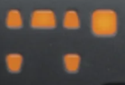

# Logitech Z906 Lights Flicker & Audio Sleep Fix

> An automated, zero-overhead Windows tray utility that stops the Logitech Z906 console lights from flashing and sleeping during quiet audio, speech pauses, or digital silence.

A tiny (~56 KB), zero-dependency Windows tray application that stops Logitech amplifiers and speaker systems (especially the **Logitech Z906**) from constantly going to sleep, dropping digital handshakes, and flashing their console LEDs during quiet scenes, podcasts, streams, videos, or games.

---

## The Problem
Logitech digital surround systems (such as the Z906) feature an aggressive silence detection circuit on digital S/PDIF and optical connections. 

When listening to content with speech pauses, quiet dialogue, or background noise suppression (podcasts, streams, videos, movies, voice chats, or games), audio frequently drops to pure digital silence (zeroes). The Logitech amplifier's DSP interprets this as a dropped signal and enters a standby/muted state. As soon as audio resumes, the amplifier has to re-synchronize:
- The console’s speaker indicator and input LEDs repeatedly **flash and cycle** like a light show.
- The first 1–2 seconds of audio can be clipped or delayed.
- An audible click/pop often occurs.

Logitech's built-in "disable auto-standby" shortcut (holding the Input/Level button for 8 seconds) only disables the 2-hour general power-off—**it does not fix the optical silence drop**.

<p align="center">
  
</p>

---

## The Solution
This app sits unobtrusively in your Windows taskbar system tray. It plays a continuous, mathematically pure, inaudible high-frequency sine tone (**23,999 Hz**) at minimal non-zero volume.

- **Why 23,999 Hz?** The standard Windows audio output format is 48,000 Hz. The Nyquist ceiling is 24,000 Hz. At 23,999 Hz, the tone is mathematically within the PCM format and safe from aliasing, while remaining **100% inaudible to human ears**.
- **Non-Zero Bitstream**: By outputting non-zero samples, the amplifier's DAC and silence detector perceive an active audio stream, keeping the digital lock engaged 24/7 without creating audible sound, heat, or speaker wear.

---

## System Tray States

The tray icon faithfully replicates the 6-speaker layout of the Logitech Z906 console display (Front-Left, Center, Front-Right, Subwoofer on the top row; Rear-Left, Rear-Right on the bottom row):

| State | Icon (32×32) | LED Color | Description |
| :--- | :---: | :--- | :--- |
| **Idle / Standby** |  | **Amber / Orange** | No keep-alive playing. In Auto mode, passively monitors system audio. |
| **Full Auto Active** |  | **Green** | System audio detected! Keep-alive tone active with self-resetting 5-minute timeout. |
| **Manual Active** |  | **Red** | Manually activated keep-alive running on a 2-hour countdown. |

---

## Operating Modes

### 1. Full Auto Mode (Default & Recommended)
- **Zero intervention needed**: The app passively monitors whether any application on your PC (browser, video player, game) is playing audio using Windows Core Audio session metering (WASAPI).
- When audio begins:
  - Keep-alive tone starts automatically.
  - The tray icon turns **Green**.
  - A **5-minute timeout** starts.
- Every time audio from other apps is detected, the 5-minute timeout **resets back to 5:00**.
- When you stop media or stream ends, after 5 consecutive minutes of silence, keep-alive turns off automatically and the icon returns to **Amber**.

### 2. Manual Mode
- **Left-click** the tray icon anytime to manually start keep-alive for **2 hours** (icon turns **Red**).
- **Left-click** again to stop immediately (icon returns to **Amber**).
- Live countdown tooltip shows remaining time (e.g. `Time remaining: 1h 45m`).

### Switching Modes
- **Right-click** the tray icon to toggle between **Full Auto Mode** and **Manual Mode**.
- Your preference is automatically remembered in `config.ini`.

---

## Quick Start
1. Download `LogitechKeepAlive.exe` from the repository or [Releases](https://github.com/).
2. Run `LogitechKeepAlive.exe` (it starts directly into your system tray).
3. Optional: Add a shortcut to your Windows Startup folder (`shell:startup`) so it runs automatically when Windows boots.

---

## Configuration (`config.ini`)
The application automatically creates `config.ini` in the same directory:

```ini
[Mode]
; 1 = Full Auto Mode (auto-detects audio, turns Green, 5m timeout)
; 0 = Manual Mode (click tray icon to turn Red for 2 hours)
FullAutoMode=1

[Audio]
; Target frequency in Hz (default: 23999.0 Hz). Nyquist ceiling at 48kHz is 24000Hz.
FrequencyHz=23999.0

; Volume percentage (1.0 = minimal non-zero volume, enough to trigger hardware silence gate)
VolumePercent=1.0

; Audio output sample rate (48000 is recommended for 23999Hz)
SampleRate=48000

[AutoMode]
; Silence duration in minutes before stopping keep-alive when no audio is detected (default: 5)
TimeoutMinutes=5

; Minimum audio level to detect active sound (default: 0.001)
PeakThreshold=0.001

[ManualMode]
; Duration in minutes when manually started via left-click or menu (default: 120 = 2 hours)
DurationMinutes=120
```

---

## Building from Source
- Requirements: Visual Studio (2019 or 2022) with C++ Desktop tools.
- Simply run `build.bat` in the project directory. It compiles `LogitechKeepAlive.exe` using `cl.exe` with standard Windows system libraries (`user32.lib`, `gdi32.lib`, `shell32.lib`, `winmm.lib`, `ole32.lib`).

---

## License
MIT License. Free to use, modify, and distribute.
